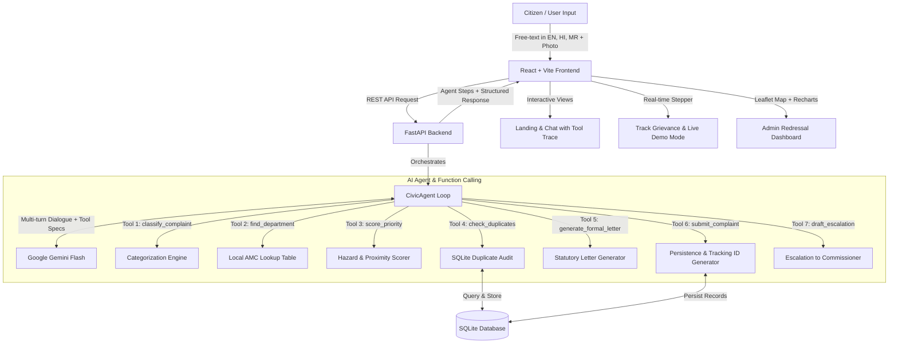

# CivicResolve — AI-Powered Civic Grievance Redressal Agent

[](https://vitejs.dev/)
[](https://tailwindcss.com/)
[](https://fastapi.tiangolo.com/)
[](https://ai.google.dev/)
[](https://sqlite.org/)

An autonomous AI Agent web application built as an **AI College Mini Project** demonstrating real **Tool Use / Function Calling** for municipal grievance routing, priority assessment, duplicate prevention, and civic tracking.

---

## 🏛️ System Architecture



---

## 🌐 Dual Portal Architecture

CivicResolve separates public citizen participation from municipal administrative governance into two dedicated portals with an instant top-bar switcher:

### 👤 1. Citizen Grievance Portal (For the People)
- **Report an Issue (`/`)**: Natural conversational interface in **English, Hindi, or Marathi**. Autonomous tool calling, photo attachment with Gemini Vision inspection, and formal petition generation.
- **Track Status (`/track`)**: Animated vertical stepper (`Submitted` $\rightarrow$ `Assigned` $\rightarrow$ `In Progress` $\rightarrow$ `Resolved`), plain-language updates, statutory escalation for overdue tickets, and a live demo mode for viva presentations.
- **Neighborhood Pulse (`community`)**: A live community wall showing issues reported across Ahilyanagar localities (Savedi, Kedgaon, Bhingar, Tarakpur, Delhi Gate, etc.) with 1-click **"I Face This Too"** upvoting to raise priority.

### 🏛️ 2. AMC Municipal Management Suite (For Ward Officers & Engineers)
- **SLA Breach Risk Radar (`mgmt_command`)**: Real-time radar identifying tickets that have exceeded or are within 24 hours of breaching the Citizen Charter SLA window.
- **Official Contractor Work Order Generator**: Generates formal municipal dispatch dockets (`WO-AMC-2026-XXXX`) with assigned Junior Field Engineers, contractor agencies, and required equipment. Automatically advances ticket status to *In Progress*.
- **Department SLA Compliance Leaderboards**: Ranks AMC departments (Roads, Water, Sanitation, Electrical, Drainage, etc.) by on-time resolution rate and case backlog.
- **Municipal Command Dashboard (`admin`)**: OpenStreetMap spatial view, telemetry cards, Gemini AI weekly intelligence summary, and filterable complaint registry with live status dropdowns.
- **Gemini AI Weekly Insight**: AI-generated municipal brief summarizing problem corridors and providing 3 actionable governance recommendations.
- **Recharts Visualizations**: Interactive Category Donut breakdown and 1–5 Priority Severity spectrum.
- **OpenStreetMap Spatial Heatmap**: Leaflet map with priority-colored pins (Red for P4-5 hazards, Amber for P3, Green for P1-2) with interactive popups and community upvoting.
- **Live Registry Table**: Filter by Category, Status, and Priority with an in-table status dropdown to update grievances on the fly.

### 4. Photographic Evidence & Vision Analysis
- Citizens can attach photos of potholes, garbage piles, or exposed streetlights.
- The vision pipeline inspects the image, evaluates severity, and pre-fills categories automatically.

---

## 🛠️ Project Structure

```
CivicAI-mini/
├── backend/
│   ├── main.py            # FastAPI REST endpoints & CORS configuration
│   ├── agent.py           # Gemini Agent Loop with Function Calling & Viva Resilience
│   ├── tools.py           # Civic tools (classification, routing, priority, duplicates)
│   ├── db.py              # SQLite database configuration & SQLAlchemy models
│   ├── schemas.py         # Pydantic request & response validation schemas
│   ├── seed.py            # Pre-seeded sample complaints across Ahilyanagar
│   ├── requirements.txt   # Python dependencies
│   ├── .env.example       # Example environment variables
│   └── .env               # Active configuration (GEMINI_API_KEY, GEMINI_MODEL)
│
├── frontend/
│   ├── index.html         # HTML entry point with Google Fonts & Leaflet styles
│   ├── vite.config.js     # Vite configuration with Tailwind CSS & API proxy
│   ├── package.json       # Frontend dependencies (React, Lucide, Recharts, Leaflet)
│   └── src/
│       ├── App.jsx        # Root application layout, navigation, and theme state
│       ├── index.css      # Design tokens, CSS variables, shimmer & print styles
│       ├── components/
│       │   ├── Navbar.jsx            # Wordmark, nav links, and dark mode toggle
│       │   ├── AgentStepsPanel.jsx   # Collapsible tool execution trace viewer
│       │   ├── ComplaintCard.jsx     # Inline result card with copyable tracking ID
│       │   └── FormalLetterModal.jsx # Formal petition viewer, printer, and exporter
│       ├── pages/
│       │   ├── LandingChatPage.jsx   # Hero, conversational agent, and photo upload
│       │   ├── TrackPage.jsx         # Stepper timeline, escalation, and demo mode
│       │   └── AdminDashboardPage.jsx# Stat cards, charts, Leaflet map, and registry
│       └── lib/
│           └── api.js                # Fetch API client
│
└── README.md              # Project documentation and viva viva preparation guide
```

---

## ⚙️ Quickstart & Setup Guide

### Prerequisites
- **Python 3.10+** (Tested with Python 3.14)
- **Node.js 18+** & **npm**

### Step 1: Backend Setup

```bash
cd backend

# 1. Install dependencies
pip install -r requirements.txt

# 2. Configure environment (Optional: add your Gemini API key)
# Copy .env.example to .env
# Edit backend/.env:
# GEMINI_API_KEY=your_gemini_api_key_here
# GEMINI_MODEL=gemini-2.5-flash

# 3. Seed database with ~15 Ahilyanagar civic complaints
python seed.py

# 4. Start the FastAPI server
uvicorn main:app --host 127.0.0.1 --port 8000 --reload
```
*The backend API will be live at `http://127.0.0.1:8000` (Swagger docs at `http://127.0.0.1:8000/docs`).*

### Step 2: Frontend Setup

In a new terminal window:

```bash
cd frontend

# 1. Install dependencies
npm install

# 2. Start the Vite development server
npm run dev
```
*Open `http://localhost:5173` in your browser.*

---

## 🎓 How the Agent Works (Viva Presentation Reference)

When explaining this project in an examination or viva:

1. **System Prompt & Role Grounding (`agent.py`)**:
   - Grounds Gemini as an empathetic, civic assistant for Ahilyanagar Municipal Corporation.
   - Constrains authority names to the verified local lookup table (`DEPARTMENT_LOOKUP`).
   - Limits conversational follow-up questions to at most 2.

2. **Function Calling Tool Declarations**:
   - `classify_complaint(text)`: Extracts standardized category and sub-issue.
   - `find_department(category)`: Identifies the responsible AMC executive division and Citizen Charter SLA turnaround days.
   - `score_priority(text, category)`: Calculates a 1–5 hazard score based on risk triggers (open manholes, live wires, hospitals, schools).
   - `check_duplicates(location, category)`: Queries SQLite for active grievances in the same vicinity.
   - `generate_formal_letter(details)`: Creates a formal petition citing the Citizen's Charter and demanding time-bound rectification.
   - `submit_complaint(data)`: Generates tracking reference (e.g. `CR-2026-0042`) and initial 4-stage lifecycle timeline.
   - `draft_escalation(complaint)`: Formulates an administrative escalation letter to higher municipal leadership.

3. **Tool Execution Loop**:
   - The agent inspects user intent. When sufficient details are present, it invokes tools sequentially.
   - Each executed tool is packaged as an `AgentStep` with tool name, status, and summary, which renders dynamically in the frontend **Agent Execution Trace** panel.
   - If duplicates are detected, the agent proactively offers an upvote path.
   - On final citizen confirmation ("Yes", "Submit"), `submit_complaint` is executed and commits the record to SQLite.

4. **Fault Tolerance & Offline Resilience**:
   - If an external Gemini API key is not supplied or free-tier quota limits are reached, the agent gracefully switches to its local deterministic pipeline without crashing, guaranteeing 100% reliability during college demonstrations.

---

## 📄 License
Created for academic project submission. Open source under the MIT License.
